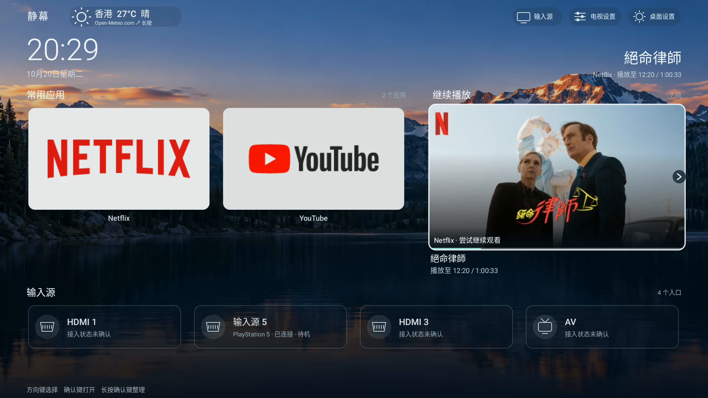

# 静幕 QuietTV

给电视一个干净、顺手的桌面。把常用应用放在眼前，换上喜欢的背景，用遥控器就能轻松操作。

**[下载安装包](https://github.com/zlsun2000/QuietTV/releases/latest)** · [安装与恢复指南](docs/INSTALL.md)

*图片是 0.12.0 在 Android TV 模拟器中的真实运行截图。新版设置菜单有所调整；你的桌面会显示自己安装的应用。*

## 能做什么？

- **整理应用**：收藏常用应用，隐藏不常用的图标，调整顺序或创建分类。
- **换个背景**：使用内置风景、自己的图片，或静音循环播放的视频。
- **继续观看或听歌**：把支持的应用的最近播放记录放到桌面，最多保留 8 条。
- **查看时间和天气**：天气可以自己开启，并选择城市。
- **遥控器操作**：方向键移动，确认键打开，长按应用卡片进行整理。

静幕免费、开源，桌面本身不放广告。天气和播放记录默认关闭，按需要开启；记录保存在电视上。

## 怎么安装？

适用于**允许安装第三方应用的 Android 6.0 及以上电视或盒子**。不是 Android 系统的电视无法安装。

1. 打开[下载页面](https://github.com/zlsun2000/QuietTV/releases/latest)，下载文件名以 `.apk` 结尾的安装包。
2. 用 U 盘或你常用的文件传输方式，把安装包送到电视上并安装。
3. 从电视的应用列表打开“静幕”，按首次使用提示设置即可。

安装时不需要电脑调试，也不需要删除原来的桌面。如果电视允许更换默认桌面，可以把静幕设为默认；部分电视会限制这一操作或在重启后返回原桌面。有些电视会阻止安装从商店以外下载的应用，遇到提示时请看[安装帮助](docs/INSTALL.md#安装失败先区分原因)。

**已装旧版？** 0.13.0、0.14.0 用户可直接安装 0.14.1，保留原设置。0.12.0 及更早版本不能直接升级；卸载会删除配置和记录，请先看[升级说明](docs/INSTALL.md#升级)。

想换回原桌面，可以在电视的默认桌面设置中重新选择它。详细步骤见[安装与恢复指南](docs/INSTALL.md)。

## 使用前知道这几件事

- **继续播放要看原应用是否支持。** 有些能接着播，有些只能打开内容或应用；不能保证每个视频、音乐应用都能精确续播。
- **更多应用可通过适配文件接入。** 有合适的文件时，可在继续播放的高级设置里导入；它能否生效取决于应用版本和电视。想制作或贡献文件，可看[适配指南](docs/PLAYBACK-RULES.md)。
- **输入源功能因电视而异。** 支持时可从桌面进入 HDMI 等输入；其他电视可能需要到系统设置中切换。
- **在线海报需要你主动启用。** 启用带在线海报的适配后，图片服务会收到你的 IP 地址和海报请求，可能据此推测观看内容。详见[隐私说明](PRIVACY.md)。
- **天气需要联网。** 开启前会说明服务条件；当前免费天气服务适用于非商业使用。
- **视频背景取决于电视的播放能力。** 不支持的视频可换成图片背景。

静幕不提供影视或音乐内容，账号与会员仍由原应用管理。其他品牌的电视还需要更多实际使用反馈，详见[兼容说明](docs/COMPATIBILITY.md)。

## 想借助 AI 做成自己的桌面？

可以从这个项目修改外观、布局或增加适合自己电视的功能。普通用户直接下载安装包即可。

[AI 定制指南](docs/CUSTOMIZATION.md) · [构建说明](docs/BUILD.md) · [贡献与反馈](CONTRIBUTING.md) · [项目写作约定](docs/WRITING.md)

源码采用 [MIT 许可](LICENSE)。[隐私说明](PRIVACY.md)、[素材与服务来源](THIRD_PARTY_NOTICES.md)、[发布前审查](docs/LEGAL-REVIEW.md)和[截图来源](docs/SCREENSHOTS.md)供需要了解细节的人查阅。

可选适配文件：[Netflix](docs/playback-rules/netflix-watch-next.json)、[TCL 渠道 B 站](docs/playback-rules/bilibili-tcl.json)。请先看[使用条件](docs/PLAYBACK-RULES.md#在电视上使用)：Netflix 仅在特定版本和设备验证过，当前 B 站 1.7.7 尚未成功适配。导入后需要手动启用，不能保证所有版本都可用。
